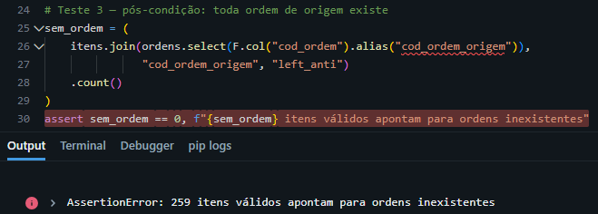
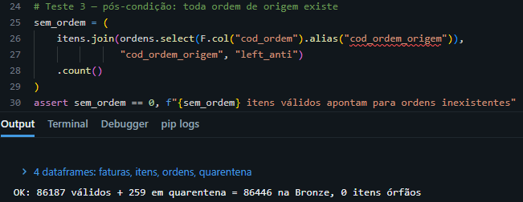

A quarentena voltou com zero linhas. Deveriam ser 259.

O notebook rodou sem nenhum erro, a contagem batia e a tabela estava pronta para alimentar o relatório financeiro. Nada indicava problema. Mesmo assim, 259 itens de faturamento sem nenhuma venda que os justificasse estavam prestes a entrar nos números da empresa.

## O problema de negócio e o S4Lake

O S4Lake é um projeto de portfólio que reproduz, com dados sintéticos, o processo Order-to-Cash de uma empresa que usa SAP: do cadastro do cliente ao recebimento da fatura. A empresa é fictícia, a Horizonte Embalagens S.A., uma indústria B2B que vende embalagens para clientes de alimentos, varejo, e-commerce, cosméticos, farmácia e autopeças em dez estados do Brasil.

O cenário é direto: a empresa fatura bem, mas o caixa não acompanha o faturamento. Quase metade das faturas é paga com atraso, e a área de Crédito e Cobrança trabalha de forma reativa, só descobrindo o problema depois que a fatura vence. Para essa área, um relatório errado não é um detalhe técnico: é cobrar o cliente errado ou deixar de cobrar quem deve.

O projeto usa Databricks Free Edition, PySpark, Delta Lake e GitHub. Os dados seguem a estrutura das tabelas do SAP e foram criados por um gerador escrito pelo Claude, que injeta problemas de qualidade de propósito e documenta cada um deles. Os dados passam pelas camadas Bronze, Silver e Gold. A falha apareceu na Silver, onde os dados são limpos e validados.

## A camada Bronze

Na Bronze, nenhum dado é corrigido. Ela é uma cópia fiel do que chegou da origem: se uma regra da Silver estiver errada, dá para reprocessar a partir dela sem voltar ao SAP.

Por isso, leio todos os campos como texto. Se o Spark inferisse os tipos, um código de cliente como `0000012345` viraria o inteiro `12345`, perdendo os zeros à esquerda e quebrando os *joins* com outras tabelas. Também adicionei colunas de auditoria (`_ingestao_em` e `_arquivo_origem`), que registram quando e de qual arquivo cada linha veio.

## As 8 duplicatas da KNA1

A `KNA1` guarda os dados gerais do cadastro de clientes (*General Data in Customer Master*). Ela chegou à Bronze com 808 registros e saiu da Silver com 800. As 8 linhas a menos eram duplicatas. No SAP, a chave da tabela é o mandante (`MANDT`) mais o código do cliente (`KUNNR`), então, dentro de um mandante, um cliente não se repete. As duplicatas não eram cópias idênticas: tinham pequenas diferenças entre si, como espaços sobrando no nome. Em um ambiente real, isso costuma acontecer quando cargas de extração se sobrepõem e o mesmo cliente chega duas vezes, em versões ligeiramente diferentes.

Remover duplicatas não é o mesmo que fazer linhas sumirem. Usei uma *window function* agrupada por `KUNNR`, com uma ordem explícita: primeiro o registro sem espaços sobrando e, em caso de empate, o mais recente. A regra produz o mesmo resultado a cada execução, e os 808 registros originais continuam na Bronze. Assim, é possível provar quais linhas foram descartadas e por quê.

## Quarentena: isolar em vez de apagar

Registros que quebram uma regra de negócio não são apagados. Eles vão para uma tabela de quarentena, com o motivo da rejeição e o momento da execução. No S4Lake, foi o caso de 449 itens de ordens de venda (`VBAP`) com quantidade zerada e de 259 itens de faturamento (`VBRP`) apontando para ordens de venda inexistentes.

Isolar em vez de apagar traz três vantagens:

1. **Rastreabilidade:** válidos mais quarentena somam o volume da Bronze (descontadas as duplicatas). Nenhum registro se perde sem explicação.
2. **Correção na origem:** quem cadastra os dados no SAP recebe a lista do que falhou e por quê.
3. **Auditoria:** o momento da execução registrado mostra quando o problema foi capturado.

### Flag ou quarentena

Nem todo dado incompleto é inválido. Dos clientes da `KNA1`, 16 não tinham CNPJ cadastrado. Eles não foram para a quarentena: receberam a *flag* `cnpj_ausente = True` e continuaram na Silver. Mesmo sem CNPJ, esse cliente pode ter faturas em aberto, e tirá-lo da Silver faria a dívida dele desaparecer do contas a receber. A quarentena fica só para registros que impedem o processamento correto.

## Validações entre tabelas

Cada tabela bater o próprio total de linhas não basta: as tabelas precisam fazer sentido juntas. No cenário do projeto, cada fatura gera exatamente um título a receber, que fica em aberto (`BSID`) até ser pago (`BSAD`). Então o total de títulos precisa ser igual ao número de faturas no cabeçalho do documento de faturamento (`VBRK`):

`3.352 títulos em aberto (BSID) + 25.373 títulos pagos (BSAD) = 28.725 faturas (VBRK)`

Essa relação 1:1 é uma regra do cenário sintético, não do SAP. No SAP real, uma fatura parcelada gera vários títulos, o `BSAD` também guarda a partida do pagamento que compensou o título, e notas de crédito entram nas mesmas tabelas. No S/4HANA, aliás, `BSID` e `BSAD` nem são tabelas físicas: são views de compatibilidade sobre a `ACDOCA`.

A conta é necessária, mas não suficiente. Uma fatura sem título e outra com título duplicado também fecham 28.725. É o mesmo tipo de soma que, no faturamento, bateu mesmo com 259 itens errados.

## O teste que revelou a falha silenciosa

Na primeira versão do notebook de faturamento, a validação conferia apenas se cada item da `VBRP` pertencia a uma fatura existente na `VBRK`. O resultado foi de 86.446 itens válidos e 0 na quarentena. Parecia perfeito.

Mas a documentação do gerador listava 259 itens apontando para ordens de venda (`AUBEL`) que não existem. A quarentena deveria ter 259 linhas. O zero mostrava que a validação estava incompleta: nada conferia se a ordem de origem de cada item existia de fato.

A correção foi adicionar a segunda regra de integridade referencial. Cada item passa por dois *left joins*, um contra as faturas e outro contra as ordens de venda, e um `when` encadeado atribui um único motivo de rejeição. Assim, um item com dois problemas entra na quarentena uma única vez, e a contagem continua batendo.

### Sem gabarito, como saber?

Eu só percebi a falha porque a documentação do gerador dizia quantos registros com problema existiam. Em um ambiente real, ninguém entrega esse gabarito. A validação precisa falhar sozinha, sem depender de alguém desconfiar dos números.

Adicionei ao final do notebook uma célula com quatro testes, que lê as tabelas já gravadas na Silver. Esta é a célula completa:

```python
from pyspark.sql import functions as F

SILVER = "workspace.s4lake_silver"
BRONZE = "workspace.s4lake_bronze"

itens      = spark.table(f"{SILVER}.faturas_venda_itens")
quarentena = spark.table(f"{SILVER}.quarentena_faturas_venda_itens")
faturas    = spark.table(f"{SILVER}.faturas_venda")
ordens     = spark.table(f"{SILVER}.ordens_venda")

n_bronze     = spark.table(f"{BRONZE}.vbrp").count()
n_validos    = itens.count()
n_quarentena = quarentena.count()

# Teste 1 — reconciliação: nenhuma linha some nem se multiplica
assert n_validos + n_quarentena == n_bronze, (
    f"Reconciliação falhou: {n_validos} + {n_quarentena} != {n_bronze}"
)

# Teste 2 — pós-condição: todo item válido pertence a uma fatura
sem_fatura = itens.join(faturas.select("cod_fatura"), "cod_fatura", "left_anti").count()
assert sem_fatura == 0, f"{sem_fatura} itens válidos sem fatura na Silver"

# Teste 3 — pós-condição: toda ordem de origem existe
sem_ordem = (
    itens.join(ordens.select(F.col("cod_ordem").alias("cod_ordem_origem")),
               "cod_ordem_origem", "left_anti")
    .count()
)
assert sem_ordem == 0, f"{sem_ordem} itens válidos apontam para ordens inexistentes"

# Teste 4 — pós-condição: nenhum item válido com quantidade zerada ou negativa
qtd_invalida = itens.filter("quantidade_faturada IS NULL OR quantidade_faturada <= 0").count()
assert qtd_invalida == 0, f"{qtd_invalida} itens válidos com quantidade inválida"

print(f"OK: {n_validos} válidos + {n_quarentena} em quarentena = {n_bronze} na Bronze, 0 itens órfãos")
```

O teste 1 confere a soma. Os outros três conferem a tabela final: cada um procura, nos itens considerados válidos, um registro que não deveria estar ali.

Para provar que os testes funcionam, reproduzi o erro: desliguei a regra da ordem de venda e rodei tudo de novo.



O detalhe mais importante não aparece na imagem: o teste 1 passou. Com a regra desligada, a conta 86.446 + 0 = 86.446 continua batendo. A reconciliação prova que nenhuma linha sumiu, mas não prova que as linhas estão no lugar certo. Quem pegou a falha foi o teste 3, de pós-condição, que verifica a tabela final sem depender da lógica que a produziu.

Com a regra religada, o resultado volta ao esperado:



Um pipeline que roda sem erro só diz que o código executou. Saber se os dados estão corretos exige testes que olhem para o resultado, e não apenas para a soma. Para a área de Cobrança da Horizonte, esses 259 itens seriam faturamento sem venda por trás, e ninguém saberia.

O notebook completo e o restante do projeto estão no repositório: [github.com/devcauas/s4lake-order-to-cash](https://github.com/devcauas/s4lake-order-to-cash).